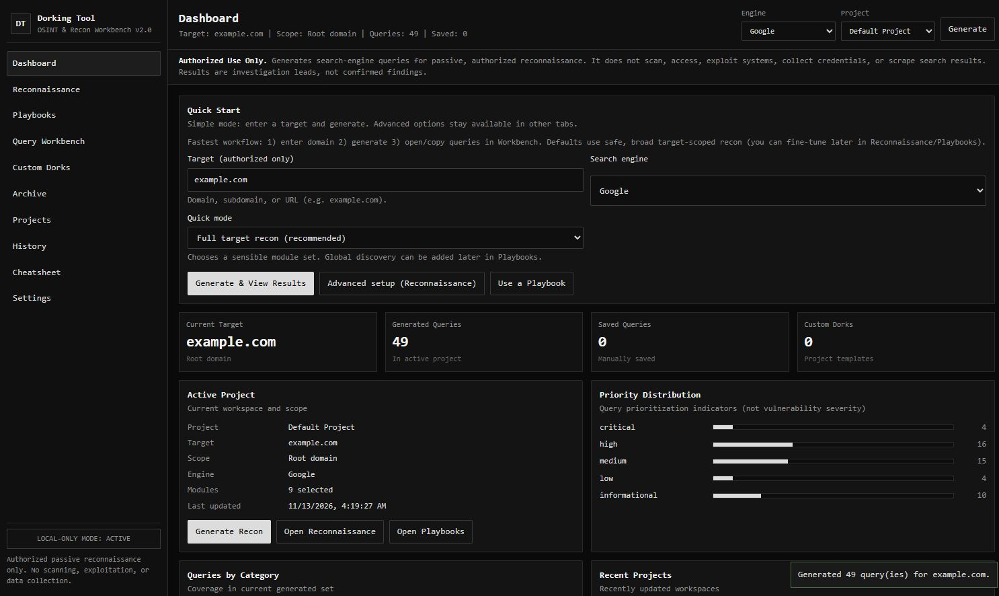
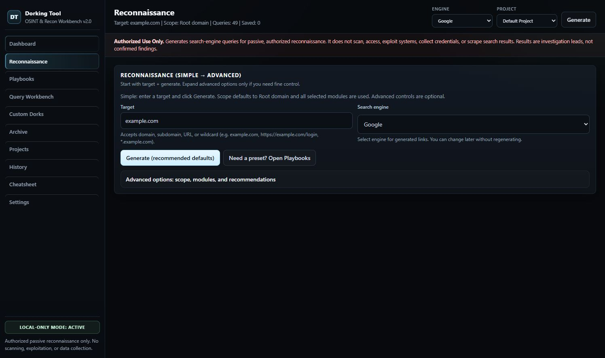
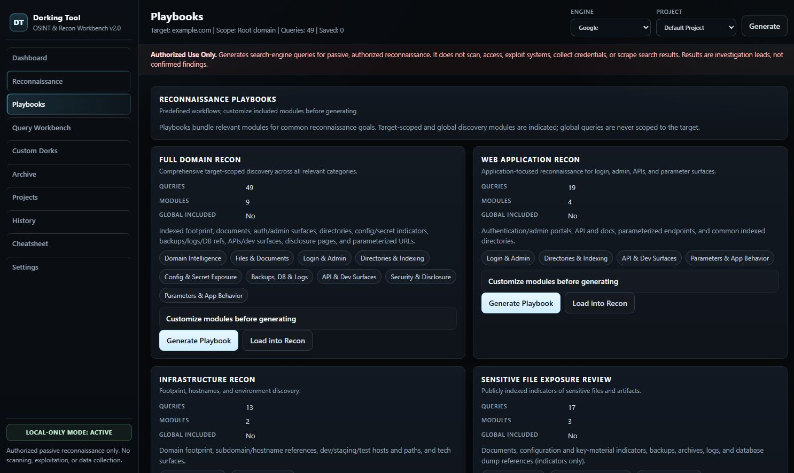
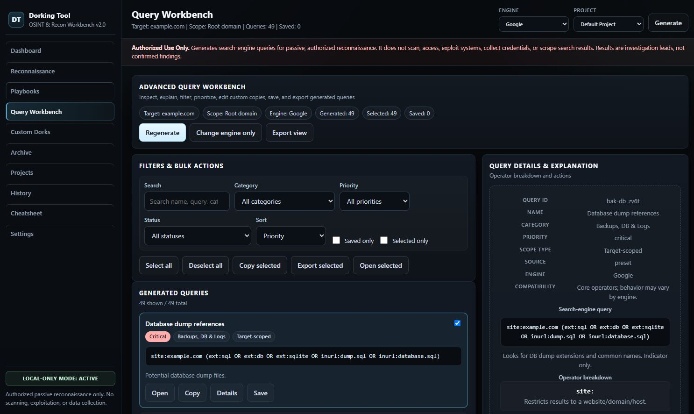
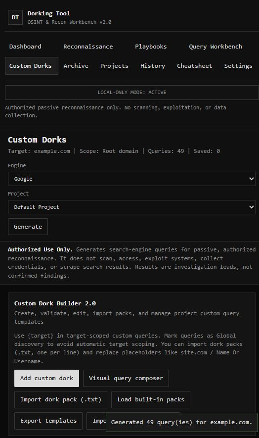
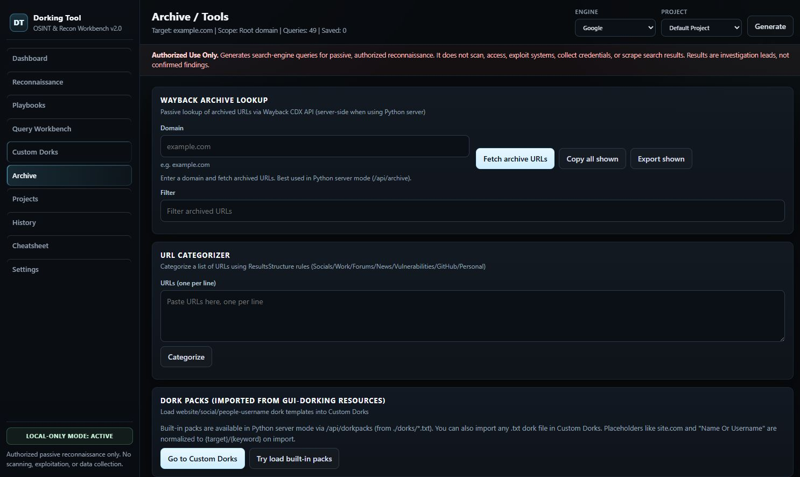

# Dorking Tool — Passive Search Reconnaissance Workbench

A local-first, browser-based workbench for **authorized, passive search-engine reconnaissance**. It helps security professionals generate, organize, review, and document search dorks (advanced search queries) as investigation leads—without scanning, exploiting, or interacting with target systems.

> **Engagement & Legal Notice**
>
> Use this tool **only** on assets you own or are explicitly authorized to assess (e.g., approved penetration tests, bug bounty programs, or internal security reviews) and in compliance with applicable laws, contracts, and rules of engagement.
>
> - **Passive by design:** generates search-engine queries/links and local workflow artifacts only.
> - **No active testing:** does not scan, crawl, probe, exploit, brute-force, authenticate, or collect credentials/sensitive data.
> - **Leads, not findings:** results and priority labels are triage/investigation aids, **not** confirmed vulnerabilities or proof of exposure.

## Overview

Dorking Tool provides a structured UI/UX for building and managing reconnaissance queries across common passive discovery themes (domain footprinting, exposed-file indicators, login/admin surfaces, indexing artifacts, API/dev references, disclosure sources, and related intelligence). It is designed for repeatable, documented workflows in professional security assessments.

**Core principles**
- **Authorized use only**
- **Passive methodology** (search-query generation and analyst workflow)
- **Local-first data handling** (browser storage; optional local helper server)
- **Transparency and traceability** (explainable queries, notes/statuses, exportable records)

## Screenshots

| Dashboard (Quick Start) | Reconnaissance (Scoping & Modules) |
| --- | --- |
|  |  |
| **Dashboard / Quick Start:** Rapid entry point for authorized targets. Select a quick workflow and search engine, generate a baseline query set, and pivot into advanced views. Displays active project context, query counts, prioritization/category distribution, and recent activity. | **Reconnaissance:** Structured target intake with normalization/validation, scope selection (root domain, root + subdomains, exact host, custom), engine selection, and module-based query generation. Supports both simple defaults and controlled advanced configuration. |

| Playbooks (Repeatable Workflows) | Query Workbench (Review & Triage) |
| --- | --- |
|  |  |
| **Playbooks:** Predefined, repeatable passive reconnaissance workflows with customizable module coverage to support consistent assessment methodology across engagements. | **Query Workbench:** Central analysis surface for generated queries. Search/filter/sort, inspect query details and operator explanations, manage manual statuses/notes, save/copy/open/export, and perform controlled bulk actions. Priority labels are investigation aids, not severity ratings. |

| Custom Dorks (Analyst Templates) | Archive / Tools (Passive Helpers) |
| --- | --- |
|  |  |
| **Custom Dorks:** Create and manage reusable query templates with placeholders (`{target}`, `{keyword}`), categorization, validation-aware editing, bulk replace, JSON import/export, and `.txt` dork-pack imports for team/library workflows. | **Archive / Tools:** Passive helper utilities including Wayback archive URL lookup and URL categorization (`ResultsStructure.json`). When run via the local server, archive lookups are proxied for improved browser compatibility; availability depends on external services/CORS/network conditions. |

## Capabilities

### Reconnaissance & Query Generation
- Target normalization and validation (domain/host/URL-style inputs)
- Scope controls: root domain, root + subdomains, exact hostname, custom scoping
- Module-driven query generation with deduplication and query explanation/operator visibility
- Multiple search-engine targets (engine-aware query/link handling)
- Playbook-based workflows for repeatable passive recon

### Analyst Workflow & Triage
- Query Workbench for review, filtering, sorting, and detailed inspection
- Manual statuses, analyst notes, and saved queries
- Copy/open/export actions (including bulk operations with safeguards)
- Project-oriented organization for engagement context

### Customization & Reuse
- Custom dork templates with placeholders and metadata
- Bulk replace and JSON import/export
- Dork pack import support (`dorks/*.txt`) with placeholder normalization
- Local URL categorization rules (`ResultsStructure.json`)

### Passive Utilities
- Wayback CDX archive lookup helper (passive historical URL discovery)
- URL categorization to assist triage and documentation

## Passive Methodology (What This Tool Does / Does Not Do)

| In scope (passive) | Out of scope (active/intrusive) |
| --- | --- |
| Generate and organize search queries for authorized targets | Port scanning, crawling, fuzzing, exploitation, or vulnerability validation |
| Open/copy search-engine query links for analyst review | Automated interaction with target infrastructure |
| Local documentation (notes/status/exports) | Credential harvesting, data exfiltration, or content collection from targets |
| Optional local proxy for archive lookups (reliability/CORS) | Search-engine scraping/bypass automation |

## Getting Started

### Option A — Local Server (Recommended)
**Requirements:** Python 3.x (standard library only)

```bash
python run.py
```

- Starts `server.py` and opens the UI at `http://127.0.0.1:8765/` (or next available port)
- Stop with `Ctrl+C`

Manual start:
```bash
python server.py
```

**Why recommended:** improves reliability for archive lookups and local pack/resource loading (e.g., CORS-sensitive browser fetches) while preserving the same UI/UX.

### Option B — Browser-Only
1. Open `index.html` in a modern browser.
2. Keep these files/folders together:
   - `index.html`, `styles.css`, `app.js`, `data.js`
   - `dorks/`, `ResultsStructure.json`

**Notes**
- Browser-only mode stores data in `localStorage`.
- Some local-file fetches and external lookups may be restricted by browser `file://`/CORS policies; use Option A if needed.

## Data Handling, Privacy, and Operational Security

- **Local-first:** project state, generated/saved queries, notes, and history are stored locally (browser `localStorage`; optional local `data_store/` when using server features that persist state).
- **No built-in telemetry:** the application does not include analytics/telemetry by default.
- **Network behavior:** the app generates search links for user-initiated review; archive lookup may query external services (e.g., Wayback CDX) when used. Treat all inputs/outputs according to engagement sensitivity.
- **Operational hygiene:** for sensitive engagements, use a dedicated browser profile, control extensions, and follow your organization’s evidence-handling/documentation procedures.

## Project Structure

- `index.html`, `styles.css`, `app.js`, `data.js` — frontend UI and application logic
- `run.py`, `server.py` — optional local launcher/server (same UI/UX)
- `dorks/*.txt` — dork pack templates
- `ResultsStructure.json` — URL categorization rules
- `screenshots/` — documentation screenshots

## Limitations

- Search operator behavior varies by engine and can change without notice.
- Indexed results depend on third-party search engines and public availability.
- Browser popup settings may restrict bulk-open actions.
- Direct archive lookups in browser-only mode may fail due to CORS/network constraints.
- Prioritization labels and generated queries are **not** evidence of compromise or vulnerability.

## Responsible Disclosure / Professional Use

- Obtain written authorization and define scope before use.
- Validate any potential exposure through approved, lawful methods within engagement scope.
- Report findings responsibly with clear evidence, impact analysis, and remediation guidance.

## License

This project is licensed under the **[MIT License](LICENSE)**.

Copyright (c) 2026 Ratnadeep Bose.

## Attribution

Dork syntax and reconnaissance patterns are based on common, publicly known search operators and community practices; adapt and use them ethically and lawfully.
