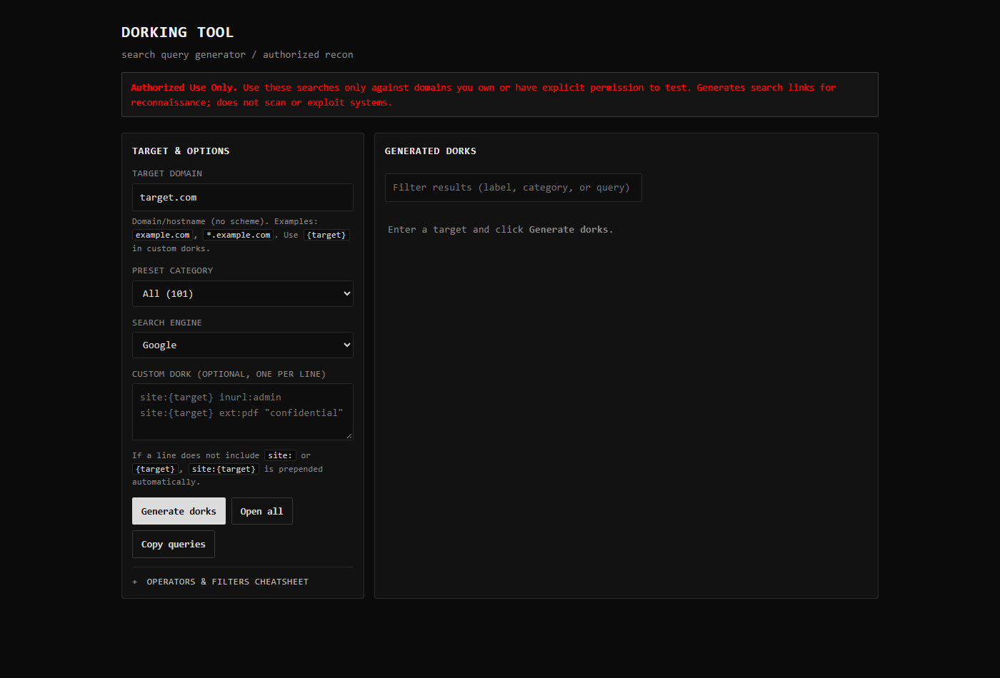
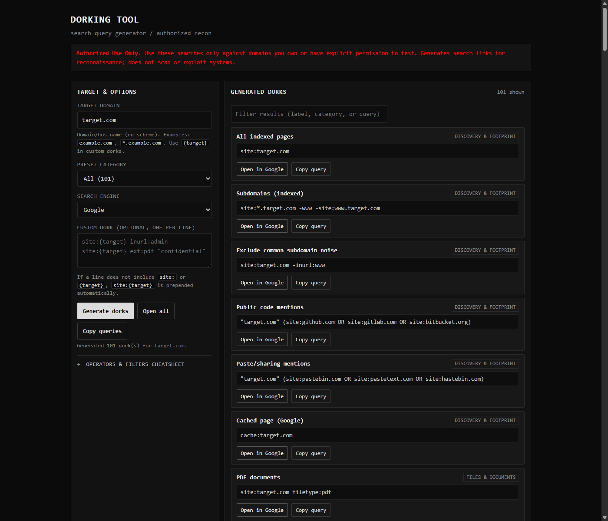
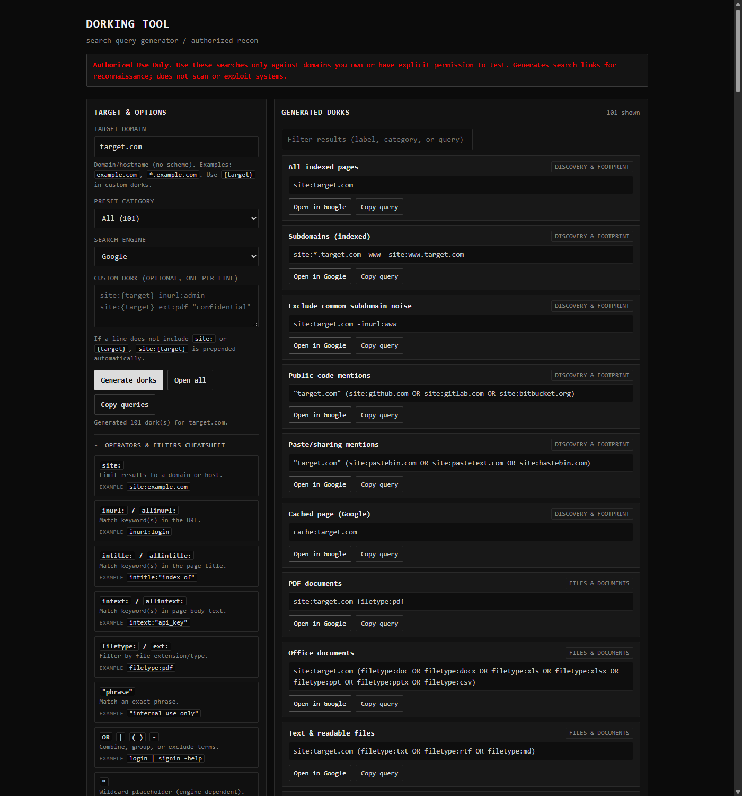

# Dorking Tool (GUI)

A local, standalone web GUI that generates search-engine **dork** queries for a target domain you are **authorized** to assess. Minimalist retro (black/gray/white, monospace) interface — no backend, no build step, no dependencies.

> **Authorized Use Only.** Use these searches only against domains you own or have explicit permission to test. This tool generates search links/queries for reconnaissance; it does not scan, access, or exploit systems. Follow applicable laws and program rules.

## Screenshots

| Initial view | Generated dorks | Cheatsheet |
| --- | --- | --- |
|  |  |  |

## What this tool is
A single-file HTML app (`index.html`) that helps you compose and run common search-engine dork queries for **authorized reconnaissance**. It builds query strings using search operators (e.g. `site:`, `inurl:`, `filetype:`) and opens them in your chosen search engine.

- **What it does:** generates target-scoped (and some global discovery) dork queries, provides one-click open/copy actions, filtering, and a built-in operator cheatsheet.
- **What it does not do:** it does **not** crawl, scan, probe, or exploit targets. It only constructs search URLs/queries; actual results come from search-engine indexing.

## Features
- **Target domain input** (e.g. `target.com`, `example.com`, `*.example.com`) with `{target}` placeholder support
- **Preset categories** (plus **All**):
  - Discovery & footprint (indexed pages, subdomains, code/paste mentions, cache)
  - Files & documents (PDF/Office/text/presentations, sensitive-doc keywords)
  - Login & admin (login/signin, admin, auth/SSO/SAML, dashboards, password reset)
  - Directories & indexing (`index of`, parent directory, common paths)
  - Config, env & secrets (recon) (`.env`, config files, `.git` hints, key filenames, secret-like keywords)
  - Backups, logs & databases (archives, SQL/DB dumps, logs, debug/error traces)
  - APIs & tech surfaces (API paths, Swagger/OpenAPI/api-docs, GraphQL, dev/staging/test hosts, common app paths)
  - Target security & disclosure (`/.well-known/security.txt`, security/disclosure/VDP pages, bug bounty/reporting, rewards/hall-of-fame, contact hints)
  - Bug bounty & disclosure (global discovery) — curated program-discovery dorks (responsible disclosure/VDP, security.txt, platform/reporting phrases, regional/country/gov/edu variants, rewards/currency mentions, etc.)
  - Parameters & app behavior (recon) (parameterized URLs, redirect-related params, common param names, search inputs)
- **Custom dorks** (one per line) with `{target}`; auto-prepends `site:{target}` when a line has no `site:`/`{target}`
- **Search engines:** Google, Bing, DuckDuckGo
- **Actions:** Generate, per-result Open/Copy, Copy all shown, Open all (popup warning), result filter (label/category/query), counts/status
- **Built-in cheatsheet:** operators & filters reference panel

## How it works
1. Enter a **target** (the app normalizes it by stripping scheme/path/whitespace).
2. Select a **preset category** and/or add **custom dork** lines.
3. Click **Generate dorks** — the app substitutes `{target}` into templates, scopes custom lines as needed, de-duplicates queries, and renders results.
4. Each result becomes a search-engine URL (URL-encoded query) you can **open** or **copy**. Everything runs client-side in your browser; the tool itself sends no data to a server (opening a link performs a normal search on the selected engine).

## Install / run

No installation or build is required — just open `index.html` in a modern browser.

### Windows
- **File Explorer:** open the `dorking-tool` folder and double-click `index.html` (or right-click → **Open with** → Edge/Chrome/Firefox).
- **PowerShell:**  
  ```powershell
  Start-Process "C:\path\to\dorking-tool\index.html"
  ```
- **Optional local server:**  
  ```powershell
  cd C:\path\to\dorking-tool
  python -m http.server 8765
  # then open http://127.0.0.1:8765/index.html
  ```

### macOS
- **Finder:** double-click `index.html` (or right-click → **Open With** → browser).
- **Terminal:**  
  ```bash
  open /path/to/dorking-tool/index.html
  ```
- **Optional local server:**  
  ```bash
  cd /path/to/dorking-tool
  python3 -m http.server 8765
  # then open http://127.0.0.1:8765/index.html
  ```

### Linux
- **File manager:** double-click `index.html` (or **Open With** → browser).
- **Terminal:**  
  ```bash
  xdg-open /path/to/dorking-tool/index.html
  # or: firefox /path/to/dorking-tool/index.html
  ```
- **Optional local server:**  
  ```bash
  cd /path/to/dorking-tool
  python3 -m http.server 8765
  # then open http://127.0.0.1:8765/index.html
  ```

**Requirements:** any modern desktop browser. Python/Node are not required unless you want the optional local server. To "install", copy the `dorking-tool` folder anywhere and open `index.html`.

## Notes & limitations
- **Authorized use only.** Assess only assets you own or have explicit permission to test.
- Operator behavior varies by engine (e.g. `cache:` is Google-specific and may be limited/unavailable). Results depend on indexing.
- **Open all** may be blocked by popup blockers — allow popups for the file/site if needed.
- Some presets are **global discovery** queries (not scoped to `{target}`), intended for finding disclosure/bug-bounty programs.

## Sources / inspiration
- Common Google dork operators/cheatsheet patterns (community cheat sheets).
- Curated public dork collections such as [Proviesec/google-dorks](https://github.com/Proviesec/google-dorks) (presets adapted/simplified for authorized, target-scoped recon).
- Bug bounty / responsible-disclosure discovery dorks provided during development (including from `c87e40dd-9f14-48fe-af72-7160a74b171c (1).zip`), added as target-scoped and global discovery presets.
